# Personagens e Heróis

[[Inicio]] · [PDF original preservado](../../../arquivo/originais/BASE%20INICIAL/Nota2.pdf) · [Texto extraído sem reordenação](../../Anexos/pdfs/Nota2/texto-integral-pypdf.txt) · [Extração na ordem de leitura](../../Anexos/pdfs/Nota2/texto-integral-pdfplumber.txt)

> Transferência integral de formato de 15 páginas. O texto abaixo segue a ordem espacial da página; os marcadores de lista que eram imagens foram representados em Markdown. Apenas as quebras de linha de diagramação foram refluídas em parágrafos. Cada página completa acompanha sua transcrição para preservar a apresentação original. A página ou o PDF deve ser consultado para verificar a disposição exata.

> Continuidade a revisar: Há menções a Fash e aos demais personagens, mas a atribuição dos diários da nova era a Firael precisa ser reconciliada em revisão editorial; nenhuma identidade ou continuidade foi deduzida automaticamente.

## Página 1

<!-- INICIO_TEXTO_FONTE -->

Personagens e Heróis

- A Família Velkyn: Ryldan (patrulheiro e estudioso narrador), Zaerith (pai e guardião da biblioteca), Lythrana (mãe clériga), Vaerion (irmão guerreiro desaparecido) e Sylra (irmã caçula).

- Firael: Autor dos diários da nova era, paladino/algoz, guerreiro calculista e fundador oculto do culto da Mente-Registro.

- Timo: O escolhido e rei abençoado por Silvanus, líder do povo da floresta; transformou-se permanentemente após os eventos das bruxas, adquirindo asas e traços animais.

<!-- FIM_TEXTO_FONTE -->

[Abrir imagem completa da página 1](../../Anexos/pdfs/Nota2/pagina-01.png)

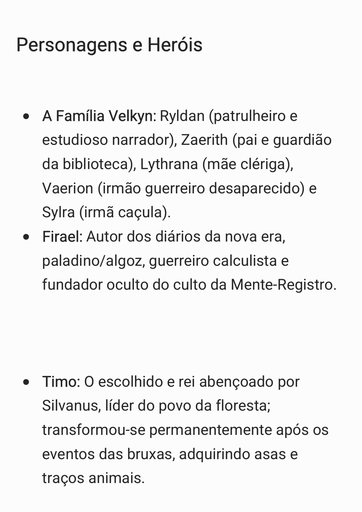

## Página 2

<!-- INICIO_TEXTO_FONTE -->

- Fash: Integrante furtivo, analítico e letal do grupo de sobreviventes.

- Kael: Mago de origens nebulosas; possui múltiplas vidas, sendo possivelmente ligado à cúpula da organização Zodíaco.

- Rake: Companheiro do grupo cuja morte em combate com o Drow fraturou as relações internas, especialmente entre Firael e Timo.

<!-- FIM_TEXTO_FONTE -->

[Abrir imagem completa da página 2](../../Anexos/pdfs/Nota2/pagina-02.png)

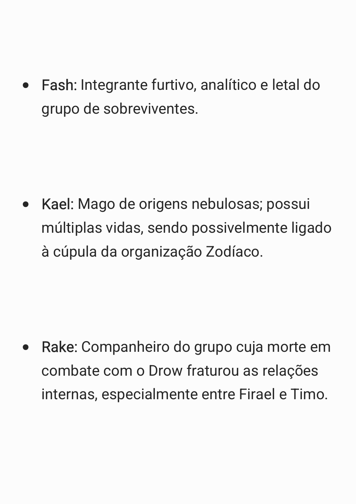

## Página 3

<!-- INICIO_TEXTO_FONTE -->

- Elena (Serethyn): Vítima sequestrada e aprisionada em um artefato pelas bruxas, indicada nos antigos grimórios não como uma mortal, mas como uma possível entidade cósmica de ordem superior.

- O Líder e o Clérigo: Regentes da cidade humana que ficaram catatônicos/iluminados permanentemente após a explosão e destruição do artefato arcano.

- Furion: Profeta e emissário da floresta, um humanoide com traços arbóreos.

<!-- FIM_TEXTO_FONTE -->

[Abrir imagem completa da página 3](../../Anexos/pdfs/Nota2/pagina-03.png)

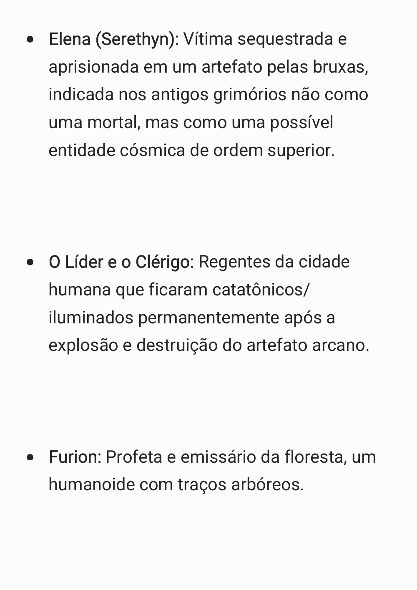

## Página 4

<!-- INICIO_TEXTO_FONTE -->

- Cogu: Lobo aliado leal de Timo, com familiares territoriais na mata.

- Anão Ferreiro: Especialista no manuseio de mithral que reforçou as defesas da cidade humana.

Vilões e Antagonistas

- O Drow Druida Sangrento (Sanguinário): O carcereiro e último sobrevivente de uma antiga guerra drow, amaldiçoado por Lolth para vigiar o Cérebro Ancião e dominar

<!-- FIM_TEXTO_FONTE -->

[Abrir imagem completa da página 4](../../Anexos/pdfs/Nota2/pagina-04.png)

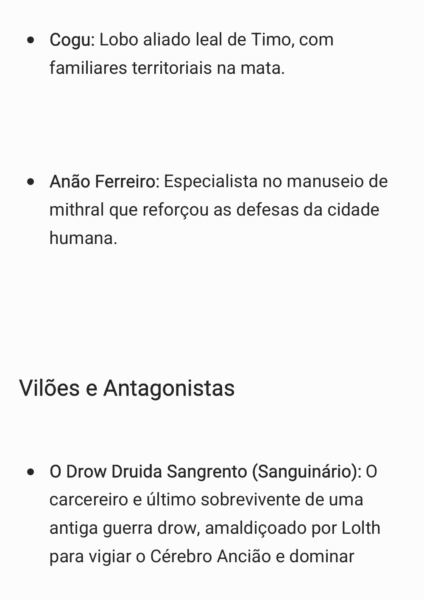

## Página 5

<!-- INICIO_TEXTO_FONTE -->

anões através de magia necromântica.

- A Líder da Convenção: Bruxa suprema que extrai poder direto do "Nó", atualmente fragilizada pela perda de sua esfera de visão.

- Morvessh, Selara e Lyvessa: Bruxas fundadoras do Círculo Vetrilus que canalizam, respectivamente, as forças conceituais de Lua, Mar e Grama.

- Líder do Zodíaco: Figura venerada como deus, dita ser imortal e capaz de renascer repetidas vezes.

<!-- FIM_TEXTO_FONTE -->

[Abrir imagem completa da página 5](../../Anexos/pdfs/Nota2/pagina-05.png)

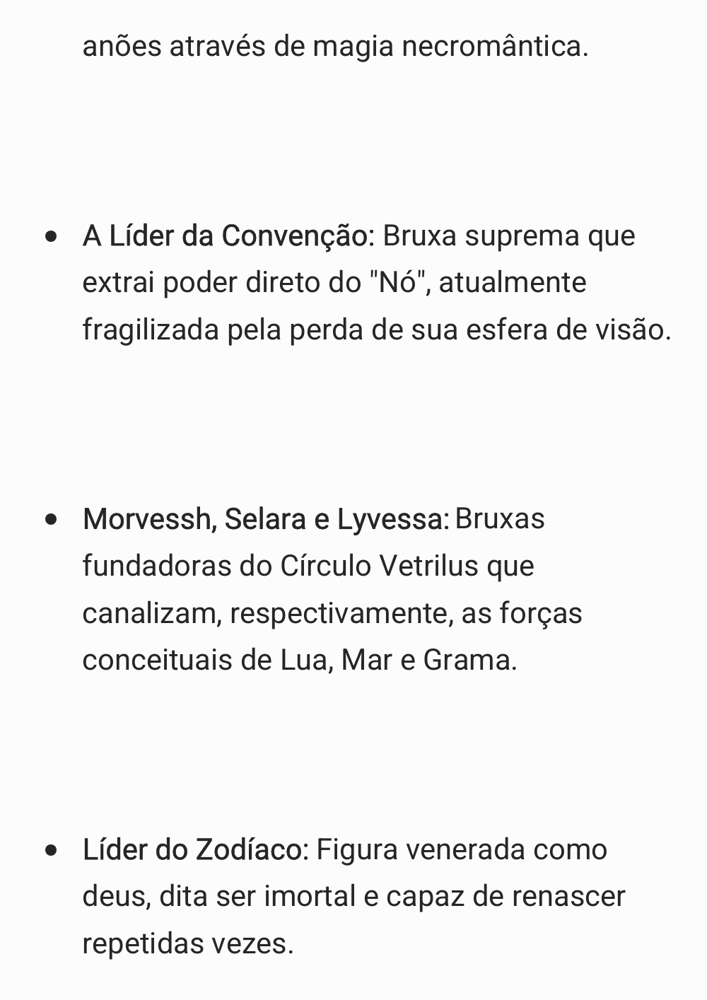

## Página 6

<!-- INICIO_TEXTO_FONTE -->

- Dragão Negro da Montanha: Entidade soberana intocável do subterrâneo que exige um rígido sistema mensal de tributos.

- Líder do Clã da Carne Negra: O brutal comandante das hostes de trolls que intermediam e extorquem ouro para o dragão.

Divindades e Dragões Históricos

<!-- FIM_TEXTO_FONTE -->

[Abrir imagem completa da página 6](../../Anexos/pdfs/Nota2/pagina-06.png)

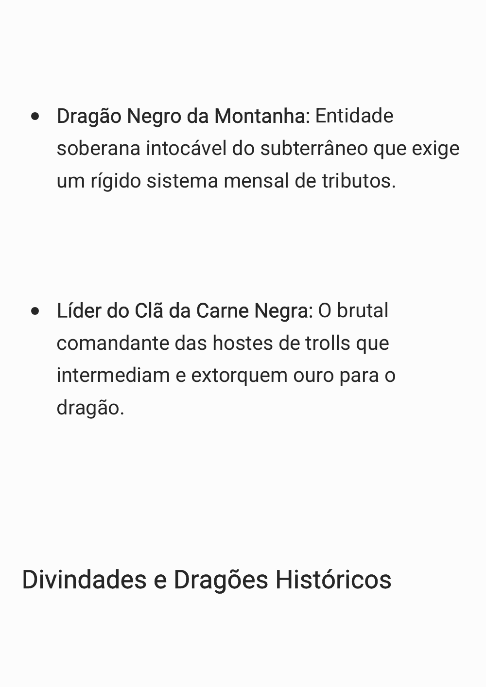

## Página 7

<!-- INICIO_TEXTO_FONTE -->

- Bahamut: O Dragão de Platina da justiça, cujos cultistas começaram a mobilizar forças nos picos antes dos cataclismos.

- Eilistraee: Deusa drow da luz do luar e redenção, padroeira de Lythrana Velkyn e Sylra.

- Lolth: A Rainha Aranha, responsável pela aniquilação e maldição da cidade do Sanguinário.

- Silvanus: O deus da natureza selvagem que tomou Timo como seu escolhido.

- Pyrotharxaziondrakulmorthvyrion (Haurim): Dragão vermelho milenar com covis

<!-- FIM_TEXTO_FONTE -->

[Abrir imagem completa da página 7](../../Anexos/pdfs/Nota2/pagina-07.png)

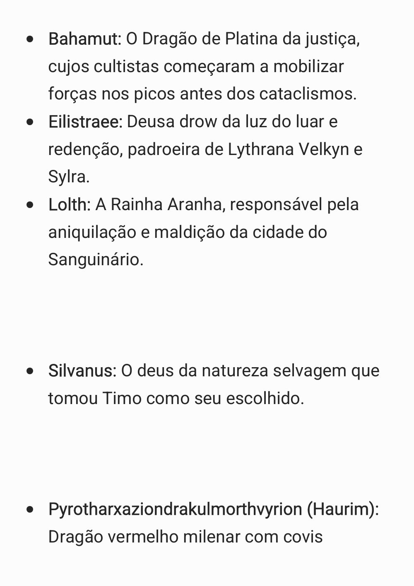

## Página 8

<!-- INICIO_TEXTO_FONTE -->

secretos espalhados pelo continente. Dragão vermelho heróico do passado, lembrado por ter rompido as castas de tirania dracônica para permitir que as raças menores civilizassem a superfície.

- Deuses-Dragões (Dragões Antigos): Entidades ancestrais mencionadas como fontes de força nas preces de Firael.

Criaturas e Ameaças

- Kharzûn, a Mente-Registro (Cérebro Ancião): Um ilitídeo gigante e aprisionado;

<!-- FIM_TEXTO_FONTE -->

[Abrir imagem completa da página 8](../../Anexos/pdfs/Nota2/pagina-08.png)

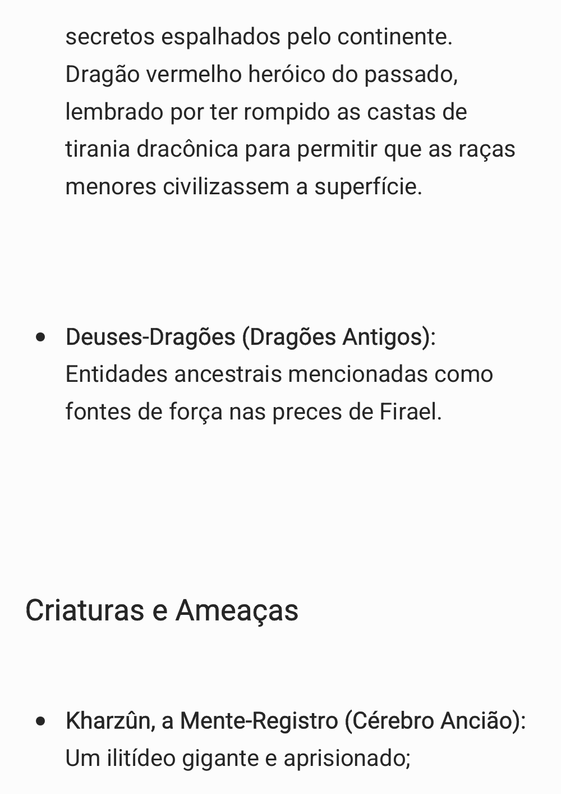

## Página 9

<!-- INICIO_TEXTO_FONTE -->

estabeleceu um pacto neural com Firael e tornou-se a "divindade" de um novo culto baseado em acumular conhecimento prático.

- Lumis: Animais, bestas e humanoides consumidos pela "doença da luz" — seres irradiantes predatórios desprovidos de mente.

- Caçadores de Dragões: Vigilantes extraplanares absolutos que chegaram pelos portais com o único foco de caçar e aniquilar dragões plenos, ignorando meio-dragões e outras raças.

<!-- FIM_TEXTO_FONTE -->

[Abrir imagem completa da página 9](../../Anexos/pdfs/Nota2/pagina-09.png)

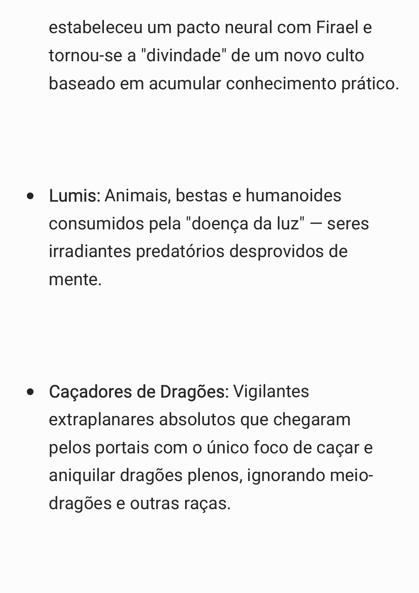

## Página 10

<!-- INICIO_TEXTO_FONTE -->

- Marrash: Seres extraplanares alados invocados por rituais de bruxaria para enraizar corrupção nas florestas.

- Ankheg: Besta escavadora capturada no subterrâneo e usada como transporte de infiltração tática.

Facções e Organizações

- A Casa Velkyn: Linhagem drow pacifista baseada perto da superfície oriental,

<!-- FIM_TEXTO_FONTE -->

[Abrir imagem completa da página 10](../../Anexos/pdfs/Nota2/pagina-10.png)

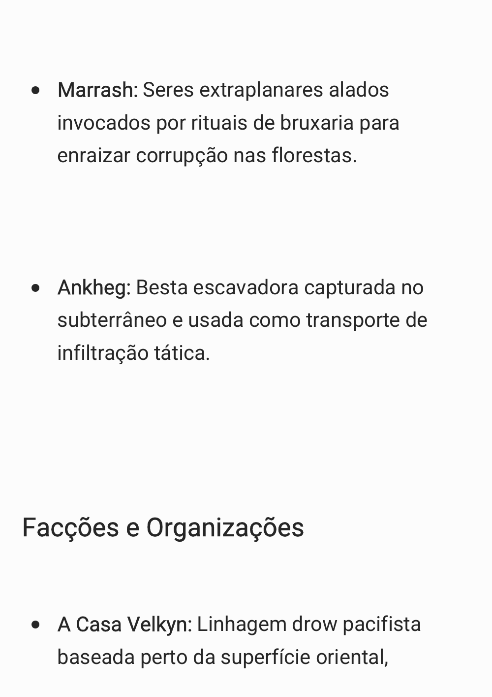

## Página 11

<!-- INICIO_TEXTO_FONTE -->

responsável por catalogar e proteger o conhecimento do passado.

- Séquito de Kharzûn (O Conclave): Religião secreta e pragmática arquitetada por Firael para proteger informações em dois santuários (bons e maus) sob a tutela telepática do ilitídeo.

- Círculo Vetrilus (A Convenção): Triunvirato das bruxas alimentado pelo Nó.

- O Zodíaco: Sociedade arcaica e tirânica que depende de 12 artefatos perdidos para recuperar seu antigo poder de obliterar cidades.

<!-- FIM_TEXTO_FONTE -->

[Abrir imagem completa da página 11](../../Anexos/pdfs/Nota2/pagina-11.png)

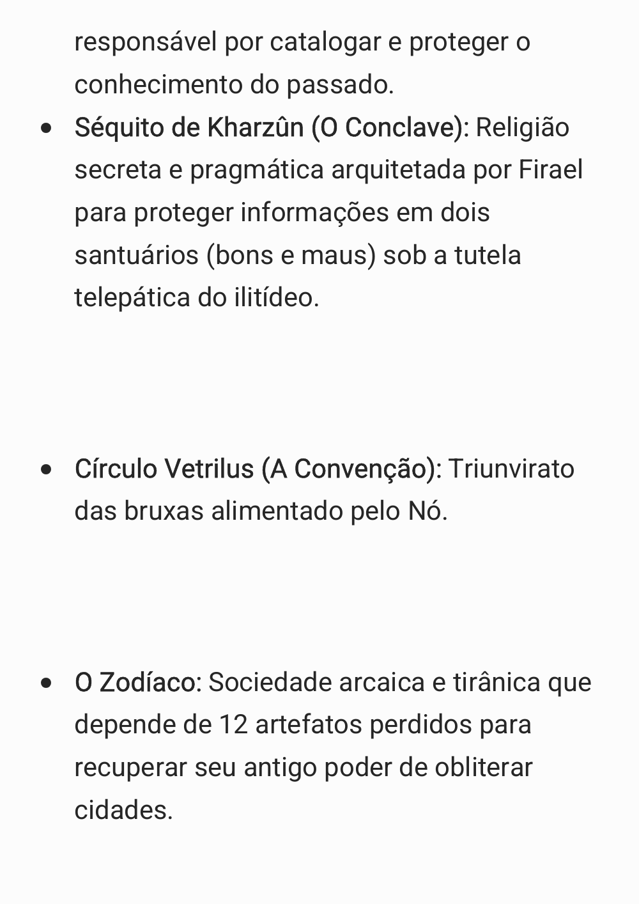

## Página 12

<!-- INICIO_TEXTO_FONTE -->

- Povo da Floresta (Seguidores de Silvanus): Aliança silvestre militarizada de fadas, ents e ninfas sob a liderança coroada de Timo.

- Guarnição Miscigenada: Batalhão de soldados exilados (meio-elfos, orcs e proscritos) estabelecido para proteger a cidade humana do sul.

Eventos, Locais e Artefatos Relevantes

<!-- FIM_TEXTO_FONTE -->

[Abrir imagem completa da página 12](../../Anexos/pdfs/Nota2/pagina-12.png)

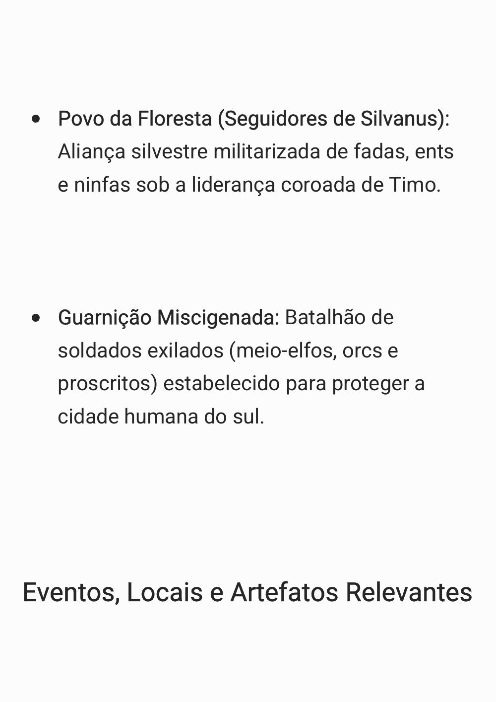

## Página 13

<!-- INICIO_TEXTO_FONTE -->

- As Doze Noites Rubras: O fenômeno sangrento que marcou a transformação apocalíptica da realidade.

- A Revoada Planar: O evento cosmológico em que incontáveis portais lançaram dragões extraplanares e caçadores de volta ao mundo.

- O Nó: A anomalia arcana de poder imensurável que abastece o Círculo Vetrilus com força maligna ilimitada.

- O Livro de Morvessh: Grimório saqueado de uma bruxa contendo diagramas, histórias e rituais corruptores detalhados.

<!-- FIM_TEXTO_FONTE -->

[Abrir imagem completa da página 13](../../Anexos/pdfs/Nota2/pagina-13.png)

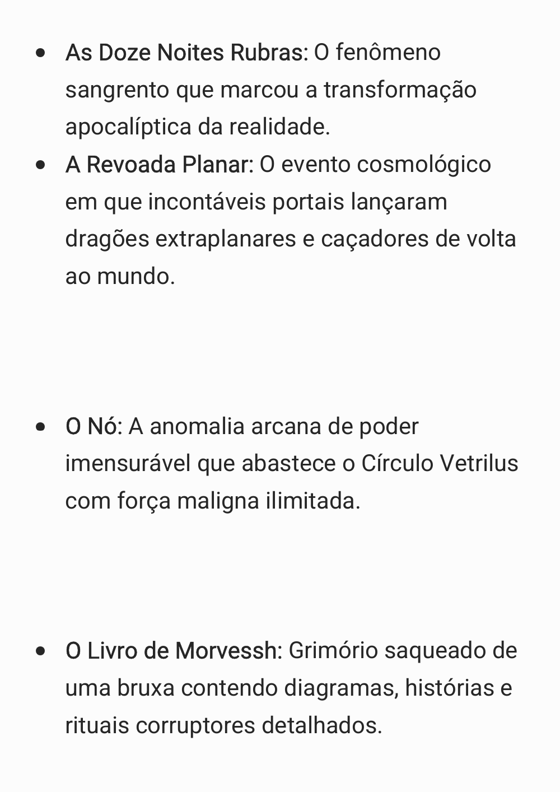

## Página 14

<!-- INICIO_TEXTO_FONTE -->

- Os Portais dos Drow:

- O Portal do Espelho: Acesso à realidade invertida e corrompida das bruxas.

- O Portal do Abismo: Passagem inativa dependente de conjuradores extremos para barganhas demoníacas.

- O Portal da Noite: Rota sociopolítica até a Ilha dos Elfos da Noite.

<!-- FIM_TEXTO_FONTE -->

[Abrir imagem completa da página 14](../../Anexos/pdfs/Nota2/pagina-14.png)

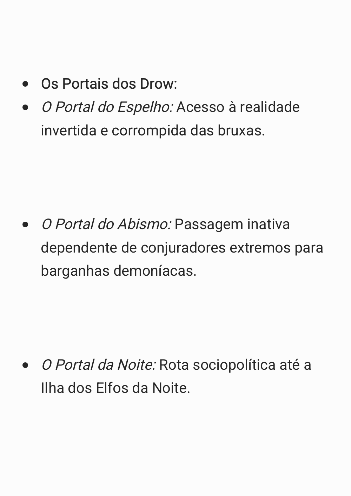

## Página 15

<!-- INICIO_TEXTO_FONTE -->

*Página sem texto extraível, visualmente em branco. O fundo original está preservado na imagem completa abaixo.*

<!-- FIM_TEXTO_FONTE -->

[Abrir imagem completa da página 15](../../Anexos/pdfs/Nota2/pagina-15.png)

## Recursos visuais extraídos

Os recursos abaixo foram extraídos sem edição. As páginas completas acima preservam sua posição e escala na fonte.

- [Fundo de página, 1800 × 2545 px](../../Anexos/pdfs/Nota2/imagens-extraidas/1605b37557cf5692.jpg); páginas 1, 2, 3, 4, 5, 6, 7, 8, 9, 10, 11, 12, 13, 14, 15.
- [Marcador de lista, 16 × 16 px](../../Anexos/pdfs/Nota2/imagens-extraidas/0ee09187c34d75b4.png); páginas 1, 2, 3, 4, 5, 6, 7, 8, 9, 10, 11, 12, 13, 14.

## Relação com a variante em texto

A BASE INICIAL também contém [Personagens e Herois.txt](../../../arquivo/originais/BASE%20INICIAL/Personagens%20e%20Herois.txt). A comparação documentada em `docs/migracao/pdf.json` preserva as diferenças; nenhuma variante foi descartada ou conciliada silenciosamente.
