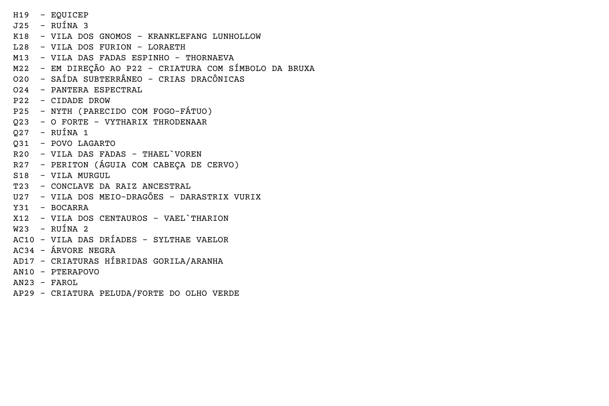
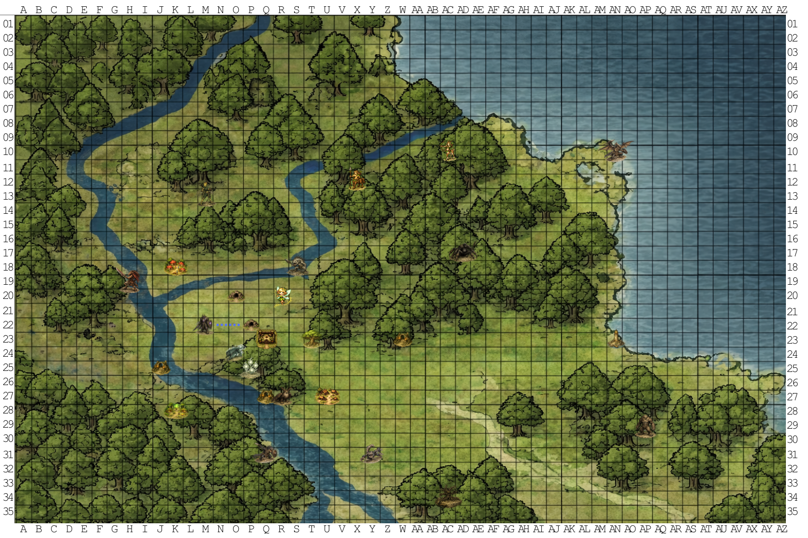

# Fash Paleskin — INTERESSES

Índice: [[Fontes/Planilhas/Fash Paleskin|Fash Paleskin]].
Fonte: [FASH PALESKIN.xlsx](../../../arquivo/originais/BASE%20INICIAL/FASH%20PALESKIN.xlsx).

Aba 3, nome original **INTERESSES**, visibilidade `visible`.
78 células com conteúdo, 0 fórmulas, 0 comentários e 0 hyperlinks.

[Dados exatos por coordenada (JSON)](../../Anexos/planilhas/fash-paleskin/aba-03.json) · [XML original da aba](../../Anexos/planilhas/fash-paleskin/ooxml/xl/worksheets/sheet3.xml).

## Conteúdo integral por coordenada

Ordem de leitura: linha e coluna originais. `∅` indica ausência de valor. Fórmulas compartilhadas aparecem expandidas para leitura; texto XML e atributos originais estão no JSON. Cache é o valor gravado, sem recálculo. Espaços, tipos e números lexicais estão no apêndice JSON. Células sem conteúdo que só definem estilo permanecem no XML.

| Célula | Valor literal | Fórmula | Valor em cache |
| --- | --- | --- | --- |
| <code>B2</code> | O Forte - Throden (Q23) | — | — |
| <code>C3</code> | ~~Nyth (P25)~~ | — | — |
| <code>D4</code> | ~~Não causa grandes problemas porém os mestiços não conseguem eliminar~~ | — | — |
| <code>C5</code> | Equicep (H19) | — | — |
| <code>D6</code> | Estão comprando escravos | — | — |
| <code>D7</code> | Existe alguns escravos do povo lagarto | — | — |
| <code>C8</code> | Lagartos Negros (Q31) | — | — |
| <code>D9</code> | Precisam de ajuda contra Ogros e Equiceps | — | — |
| <code>C10</code> | Periton (R27) | — | — |
| <code>D11</code> | Águia com cabeça de cervo | — | — |
| <code>C12</code> | Bocarra (Y31) | — | — |
| <code>C14</code> | Árvore Negra (AC34) | — | — |
| <code>C16</code> | Gorila/Aranha (AD17) | — | — |
| <code>D17</code> | 40 individuos | — | — |
| <code>C18</code> | Pteropovo (AN10) | — | — |
| <code>D19</code> | Não tem atuação na terra | — | — |
| <code>C20</code> | Criatura Peluda do Olho Verde (AP29) | — | — |
| <code>D21</code> | Criatura inteligente, emboscou e roubou, não era o objetivo matar. | — | — |
| <code>D22</code> | 50 indíviduos | — | — |
| <code>B23</code> | Necromante | — | — |
| <code>C24</code> | ~~Fantasma me seguindo/espionando (Foi embora)~~ | — | — |
| <code>C25</code> | ~~Ossos de Dragão (Concluído)~~ | — | — |
| <code>C26</code> | Necrópole (H20) | — | — |
| <code>C27</code> | Missão: Caminho Underground no Fosso de Ossos | — | — |
| <code>C28</code> | Missão: Firael/Elder Brain | — | — |
| <code>B29</code> | Conclave da Raiz Ancestral (T23) | — | — |
| <code>C30</code> | Gnomos (K18) | — | — |
| <code>C32</code> | Murgul (S18) | — | — |
| <code>C34</code> | Furion (K28) | — | — |
| <code>C36</code> | Fadas Espinho (M13) | — | — |
| <code>C38</code> | Fadas Pixie (R20) | — | — |
| <code>D39</code> | Cavaleiro da Morte Selado | — | — |
| <code>D40</code> | Selo enfraquecendo e corrompendo a terra. | — | — |
| <code>D41</code> | Trent Ancião Corrompido (ND11) pode ter informações | — | — |
| <code>C42</code> | Centauros (X12) | — | — |
| <code>D43</code> | Dragonetes da Fúria | — | — |
| <code>D44</code> | Esmagador Encouraçado (ND 9-12) | — | — |
| <code>C45</code> | Driades (AC10) | — | — |
| <code>B47</code> | Cidade Drow (P22) | — | — |
| <code>C48</code> | Portal: Abismo | — | — |
| <code>C49</code> | Portal: Mundo Espelhado | — | — |
| <code>C50</code> | Portal: Ilha dos Elfos da Noite | — | — |
| <code>C51</code> | ~~Portal: Cabeça de Gigante~~ | — | — |
| <code>C52</code> | ~~Portal: 4 Costelas Grandes~~ | — | — |
| <code>C53</code> | Caminhos Underground | — | — |
| <code>D54</code> | Caminho com três bifurcações | — | — |
| <code>E55</code> | Chitine | — | — |
| <code>E56</code> | ? | — | — |
| <code>E57</code> | Beholder | — | — |
| <code>D58</code> | Caminho no Fosso de Ossos | — | — |
| <code>D59</code> | Caminho para os Trolls | — | — |
| <code>C60</code> | Subterrêneo: Dragão Negro | — | — |
| <code>D61</code> | 100 peças de ouro por mês | — | — |
| <code>C62</code> | Subterrâneo: Gnomos | — | — |
| <code>C63</code> | Subterrâneo: Trolls | — | — |
| <code>D64</code> | Itens de Mitral Corrompido | — | — |
| <code>D65</code> | Arena | — | — |
| <code>D66</code> | Líder de 3 cabeças | — | — |
| <code>D67</code> | Firael vai lutar na arena | — | — |
| <code>C68</code> | Subterrâneo: Orcs | — | — |
| <code>C69</code> | Subterrâneo: Duergars | — | — |
| <code>C70</code> | Subterrâneo: Crias Dracônicas de Dragão das Profundezas (O20) | — | — |
| <code>C71</code> | Subterrâneo: Quitiina (Knowledge 32) | — | — |
| <code>D72</code> | Ladinos | — | — |
| <code>D73</code> | Criados por Drows | — | — |
| <code>C74</code> | Subterrâneo: Aracnideo (Template) (Knowledge 46) | — | — |
| <code>D75</code> | Vários tamanhos | — | — |
| <code>D76</code> | Veneno varia pelo tamanho | — | — |
| <code>C77</code> | Subterrâneo: Beholder | — | — |
| <code>B78</code> | Ruínas | — | — |
| <code>C79</code> | Floresta do Timo (W23) | — | — |
| <code>C80</code> | Embaixo do Rio (J25) | — | — |
| <code>C81</code> | ? (Q27) | — | — |
| <code>B82</code> | Covis de Haurim | — | — |
| <code>C83</code> | Duas montanhas ao sul | — | — |
| <code>B84</code> | Bruxas | — | — |
| <code>C85</code> | Morvessh, Selara e Lyvessa | — | — |
| <code>C86</code> | Nodo | — | — |

O texto riscado reproduz a marcação visual da fonte; uma rasura, por si só, não prova conclusão nem define o estado atual do assunto.

## Comentários

Nenhum comentário no arquivo.

## Hyperlinks

Nenhum hyperlink no arquivo.

## Mesclagens

Nenhuma mesclagem no arquivo.

## Imagens e outros objetos

### Objeto 1 — image1.png

Âncora: <code>I31</code>. Tipo: <code>oneCellAnchor</code>. Offsets e dimensões exatos no JSON.

Titulo: Imagem



### Objeto 2 — image2.png

Âncora: <code>I1</code>. Tipo: <code>oneCellAnchor</code>. Offsets e dimensões exatos no JSON.

Titulo: Imagem



### Transcrição visual da legenda incorporada

Texto da imagem `image1.png`, ancorada em `I31`. A imagem original acima permanece a referência. Grafias e coordenadas próprias da imagem foram mantidas, inclusive quando diferem das células.

```text
H19 - EQUICEP
J25 - RUÍNA 3
K18 - VILA DOS GNOMOS - KRANKLEFANG LUNHOLLOW
L28 - VILA DOS FURION - LORAETH
M13 - VILA DAS FADAS ESPINHO - THORNAEVA
M22 - EM DIREÇÃO AO P22 - CRIATURA COM SÍMBOLO DA BRUXA
O20 - SAÍDA SUBTERRÂNEO - CRIAS DRACÔNICAS
O24 - PANTERA ESPECTRAL
P22 - CIDADE DROW
P25 - NYTH (PARECIDO COM FOGO-FÁTUO)
Q23 - O FORTE - VYTHARIX THRODENAAR
Q27 - RUÍNA 1
Q31 - POVO LAGARTO
R20 - VILA DAS FADAS - THAEL`VOREN
R27 - PERITON (ÁGUIA COM CABEÇA DE CERVO)
S18 - VILA MURGUL
T23 - CONCLAVE DA RAIZ ANCESTRAL
U27 - VILA DOS MEIO-DRAGÕES - DARASTRIX VURIX
Y31 - BOCARRA
X12 - VILA DOS CENTAUROS - VAEL`THARION
W23 - RUÍNA 2
AC10- VILA DAS DRÍADES - SYLTHA VAELOR
AC34 - ÁRVORE NEGRA
AD17 - CRIATURAS HÍBRIDAS GORILA/ARANHA
AN10 - PTERAPOVO
AN23 - FAROL
AP29 - CRIATURA PELUDA/FORTE DO OLHO VERDE
```


## Estrutura e preservação

As dimensões de linhas/colunas, linhas/colunas ocultas, filtros, validações, formatação condicional, configurações de impressão, relações e demais metadados permanecem no [JSON da aba](../../Anexos/planilhas/fash-paleskin/aba-03.json) e no [XML original](../../Anexos/planilhas/fash-paleskin/ooxml/xl/worksheets/sheet3.xml).

Markdown apresenta texto e dados, sem reproduzir o posicionamento visual e a interatividade do Excel. O [XLSX original](../../../arquivo/originais/BASE%20INICIAL/FASH%20PALESKIN.xlsx) acompanha a conversão para esses recursos.
