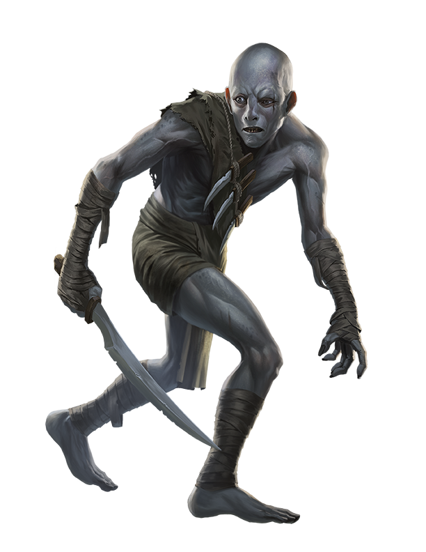
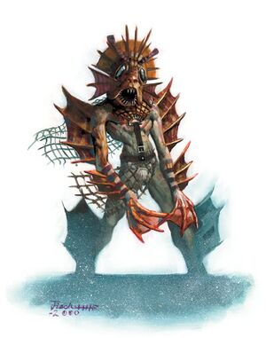
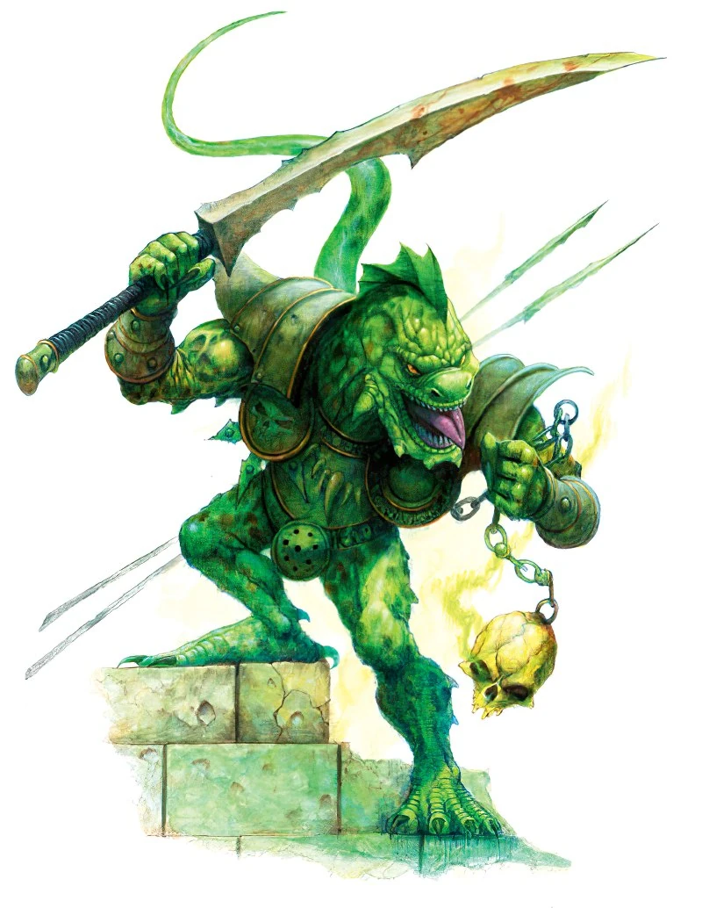
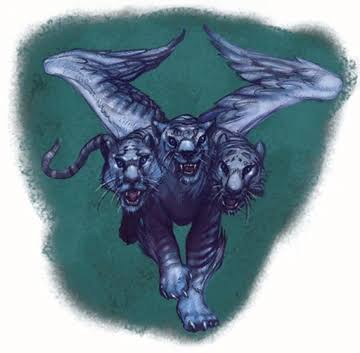

# Glim Sombrasselva — ALTERSELF & POLYMORPH

Índice: [[Fontes/Planilhas/Glim Sombrasselva|Glim Sombrasselva]].
Fonte: [GLIM SOMBRASSELVA.xlsx](../../../arquivo/originais/BASE%20INICIAL/GLIM%20SOMBRASSELVA.xlsx).

Aba 7, nome original **ALTERSELF &amp; POLYMORPH**, visibilidade `visible`.
37 células com conteúdo, 0 fórmulas, 0 comentários e 6 hyperlinks.

[Dados exatos por coordenada (JSON)](../../Anexos/planilhas/glim-sombrasselva/aba-07.json) · [XML original da aba](../../Anexos/planilhas/glim-sombrasselva/ooxml/xl/worksheets/sheet7.xml).

## Conteúdo integral por coordenada

Ordem de leitura: linha e coluna originais. `∅` indica ausência de valor. Fórmulas compartilhadas aparecem expandidas para leitura; texto XML e atributos originais estão no JSON. Cache é o valor gravado, sem recálculo. Espaços, tipos e números lexicais estão no apêndice JSON. Células sem conteúdo que só definem estilo permanecem no XML.

| Célula | Valor literal | Fórmula | Valor em cache |
| --- | --- | --- | --- |
| <code>B2</code> | HANDBOOK | — | — |
| <code>B4</code> | SKULK | — | — |
| <code>D4</code> | TREN | — | — |
| <code>F4</code> | LOCATHAH | — | — |
| <code>H4</code> | AVARIAL | — | — |
| <code>J4</code> | Leskylor  | — | — |
| <code>A5</code> | Size | — | — |
| <code>B5</code> | M | — | — |
| <code>D5</code> | M | — | — |
| <code>F5</code> | M | — | — |
| <code>H5</code> | M | — | — |
| <code>A6</code> | Natural Armor | — | — |
| <code>B6</code> | - | — | — |
| <code>D6</code> | 8.0 | — | — |
| <code>F6</code> | 3.0 | — | — |
| <code>H6</code> | - | — | — |
| <code>A7</code> | Movement | — | — |
| <code>B7</code> | 30ft | — | — |
| <code>D7</code> | 30ft, 40ft swim | — | — |
| <code>F7</code> | 10ft, 60ft swim | — | — |
| <code>H7</code> | 30ft, 50ft fly | — | — |
| <code>A8</code> | Skills | — | — |
| <code>B8</code> |  +8 Mov.S., +15 to Hide | — | — |
| <code>D8</code> |  +4 Hide (+8 in rocky/subterranean) | — | — |
| <code>F8</code> |  +8 Swim (take 10) | — | — |
| <code>H8</code> |  +4 Spot/Jump, +2 Listen/Search | — | — |
| <code>A9</code> | Attacks | — | — |
| <code>B9</code> | - | — | — |
| <code>D9</code> | 2x claw(1d4), bite(1d4) | — | — |
| <code>F9</code> | - | — | — |
| <code>H9</code> | - | — | — |
| <code>A10</code> | Feats | — | — |
| <code>B10</code> | - | — | — |
| <code>D10</code> | Multiattack | — | — |
| <code>F10</code> | - | — | — |
| <code>H10</code> | - | — | — |
| <code>H28</code> | s | — | — |

## Comentários

Nenhum comentário no arquivo.

## Hyperlinks

| Intervalo | Destino original | Atributos adicionais |
| --- | --- | --- |
| <code>B2</code> | https://minmaxforum.com/index.php?topic=2811.0 [abrir](<https://minmaxforum.com/index.php?topic=2811.0>) | <code>{}</code> |
| <code>B4</code> | https://dnd.arkalseif.info/races/races-of-destiny--81/skulk--42/index.html [abrir](<https://dnd.arkalseif.info/races/races-of-destiny--81/skulk--42/index.html>) | <code>{}</code> |
| <code>D4</code> | https://www.realmshelps.net/monsters/block/Tren [abrir](<https://www.realmshelps.net/monsters/block/Tren>) | <code>{}</code> |
| <code>F4</code> | https://www.d20srd.org/srd/monsters/locathah.htm [abrir](<https://www.d20srd.org/srd/monsters/locathah.htm>) | <code>{}</code> |
| <code>H4</code> | https://dnd.arkalseif.info/races/races-of-faerun--23/avariel--95/index.html [abrir](<https://dnd.arkalseif.info/races/races-of-faerun--23/avariel--95/index.html>) | <code>{}</code> |
| <code>J4</code> | https://www.realmshelps.net/monsters/block/Leskylor [abrir](<https://www.realmshelps.net/monsters/block/Leskylor>) | <code>{}</code> |

## Mesclagens

22 intervalos mesclados, na ordem do XML:

```text
B5:C5
F5:G5
H5:I5
B6:C6
D6:E6
F6:G6
H6:I6
B8:C8
B9:C9
D9:E9
F9:G9
H9:I9
B10:C10
F10:G10
H10:I10
B7:C7
D7:E7
F7:G7
H7:I7
D8:E8
F8:G8
H8:I8
```

## Imagens e outros objetos

### Objeto 1 — image5.png

Âncora: <code>A11</code>. Tipo: <code>oneCellAnchor</code>. Offsets e dimensões exatos no JSON.

Titulo: Imagem



### Objeto 2 — image2.png

Âncora: <code>E11</code>. Tipo: <code>oneCellAnchor</code>. Offsets e dimensões exatos no JSON.

Titulo: Imagem



### Objeto 3 — image1.png

Âncora: <code>C11</code>. Tipo: <code>oneCellAnchor</code>. Offsets e dimensões exatos no JSON.

Titulo: Imagem



### Objeto 4 — image4.png

Âncora: <code>G11</code>. Tipo: <code>oneCellAnchor</code>. Offsets e dimensões exatos no JSON.

Titulo: Imagem


### Objeto 5 — image3.png

Âncora: <code>I11</code>. Tipo: <code>oneCellAnchor</code>. Offsets e dimensões exatos no JSON.

Titulo: Image




## Estrutura e preservação

As dimensões de linhas/colunas, linhas/colunas ocultas, filtros, validações, formatação condicional, configurações de impressão, relações e demais metadados permanecem no [JSON da aba](../../Anexos/planilhas/glim-sombrasselva/aba-07.json) e no [XML original](../../Anexos/planilhas/glim-sombrasselva/ooxml/xl/worksheets/sheet7.xml).

Markdown apresenta texto e dados, sem reproduzir o posicionamento visual e a interatividade do Excel. O [XLSX original](../../../arquivo/originais/BASE%20INICIAL/GLIM%20SOMBRASSELVA.xlsx) acompanha a conversão para esses recursos.
