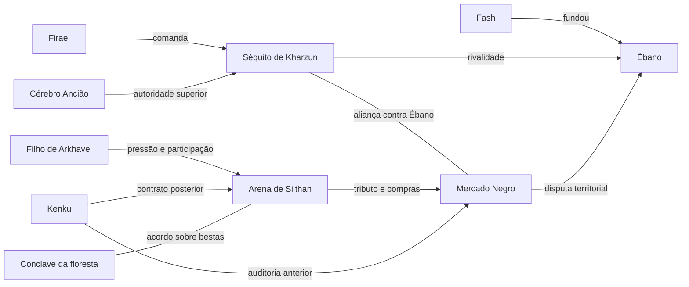

# Relações de poder

Relações de poder documentadas, com foco nas cartas e revelações do arco da arena. O diagrama é um resumo dessas relações em seus momentos registrados; não declara que todos os contratos sobreviveram à queda da arena ou ao saque de Eral.

| Relação | Natureza e limite | Fontes |
| --- | --- | --- |
| [[Personagens/Fash Paleskin]] → [[Faccoes/Ebano]] | Fundação confirmada; comando atual de Fash aberto. | [[Fontes/Vault/Vault - 2026-10-23 - Esclarecimentos do jogador sobre Fash e Glim|J]] |
| [[Personagens/Firael]] e [[Personagens/Cerebro Anciao]] → [[Faccoes/Organizacao de Firael|Séquito de Kharzun]] | Liderança com Cérebro acima de Firael, explicada em T25. | [[Fontes/Vault/Vault - RPG - Handoff do cenario para o mestre|H]]; [[Fontes/Vault/Vault - 2026-10-23 - Esclarecimentos do jogador sobre Fash e Glim|J]] |
| [[Faccoes/Organizacao de Firael|Séquito de Kharzun]] + [[Faccoes/Mercado Negro]] | Aliança contra Ébano; objetivo dos mapas de Eral contraditório. | [[Fontes/Vault/Vault - RPG - Handoff do cenario para o mestre|H]] |
| [[Faccoes/Arena de Silthan]] → [[Faccoes/Mercado Negro]] | Tributo e compra de cativos, não identidade automática das organizações. | [[Fontes/Vault/Vault - RPG - Handoff do cenario para o mestre|H]] |
| [[Personagens/Filho de Arkhavel ligado ao prefeito]] + Aboleth | Parceria secreta, desconhecida de Mercado e Silthan, segundo cartas. | [[Fontes/Vault/Vault - RPG - Handoff do cenario para o mestre|H]] |
| [[Faccoes/Kenku de Eral]] → Mercado, depois Silthan | Auditoria encerrada e contratação direta posterior; traição a Eral é outro momento. | [[Fontes/Vault/Vault - RPG - Handoff do cenario para o mestre|H]] |
| [[Faccoes/Conclave da floresta]] e arena | Responsabilidade e acordo revelados; não confundir com Círculo Vetrilus. | [[Fontes/Vault/Vault - RPG - Handoff do cenario para o mestre|H]] |

As descrições do diagrama são uma síntese do handoff; as notas temáticas indicam os trechos primários examinados e as pendências específicas. Veja [[Pendencias/Faccoes/FC-003 - Aliança de Firael com o Mercado e operação em Eral|FC-003 — consulta encerrada, motivação desconhecida]] e [[Pendencias/Faccoes/FC-005 - Informante investigado pelo Mercado|FC-005 — consulta encerrada, suspeita não confirmada]].

O nome oficial **Séquito de Kharzun** foi confirmado pelo jogador; a denominação anterior organização de Firael permanece como alias. [[Fontes/Confirmacoes/2026-10-30 - Nome oficial Sequito de Kharzun confirmado|Confirmação do jogador — 30/10/2026]]

A aparente contradição entre a aliança e a operação local é uma intriga sem explicação conhecida pelos jogadores; FC-003 foi encerrada como consulta. [[Fontes/Confirmacoes/2026-10-30 - Intriga de Firael e Mercado sem explicacao conhecida|Esclarecimento do jogador — 30/10/2026]]

A suspeita do grupo sobre um sacerdote de Kord, talvez impostor, foi registrada sem confirmação de identidade ou autoria. FC-005 foi encerrada como consulta. [[Fontes/Confirmacoes/2026-10-30 - Suspeita sobre sacerdote de Kord como informante|Esclarecimento do jogador — 30/10/2026]]
